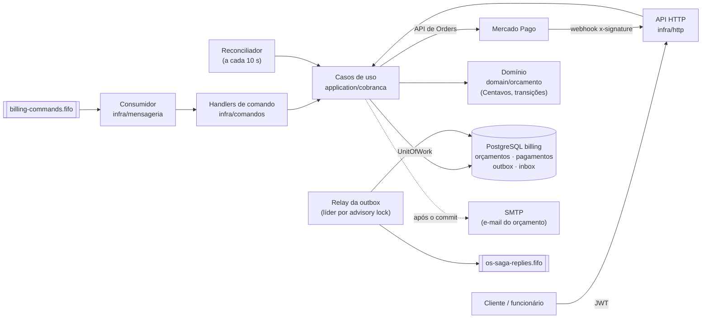
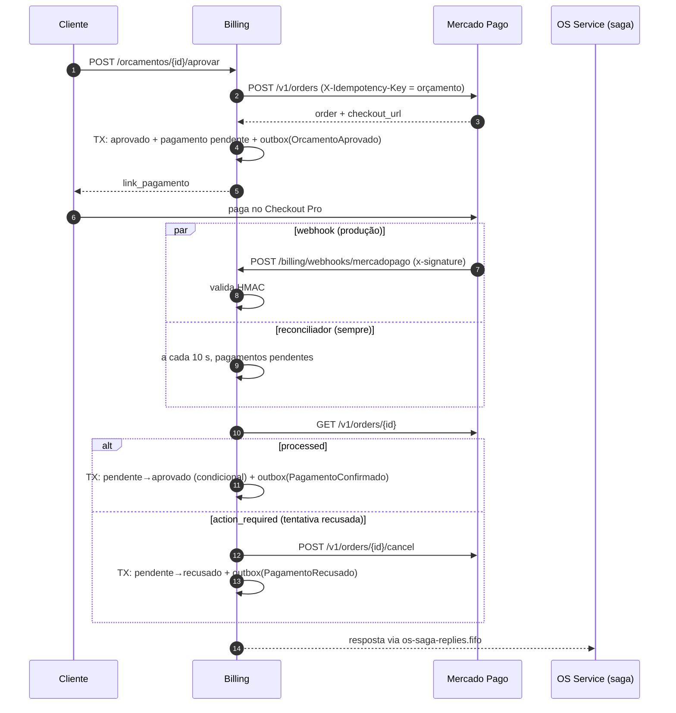
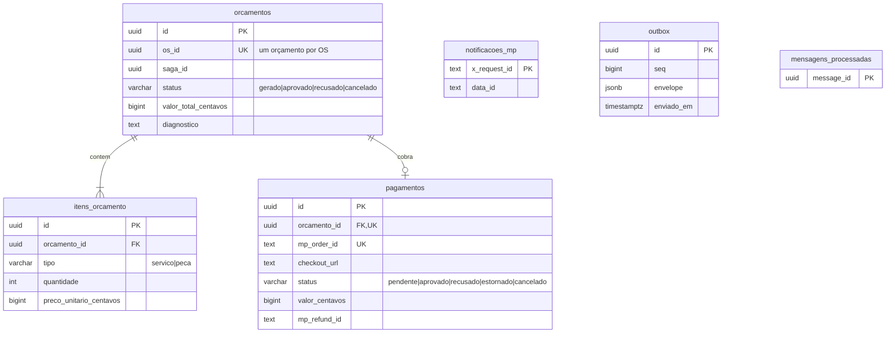

# Arquitetura — Billing Service

> Visão do serviço dentro da saga da Fase 4. O desenho completo do sistema (os 3 serviços, AWS, catálogo de mensagens) está em [`oficina-app/docs/planejamentos/fase-4/arquitetura.md`](https://github.com/ProblemaTheu/oficina-app/blob/main/docs/planejamentos/fase-4/arquitetura.md); as decisões, nas [ADRs 009–016](https://github.com/ProblemaTheu/oficina-app/blob/main/docs/architecture-decisions.md).

## 1. Componentes

| Pacote | Papel |
|---|---|
| `internal/domain/orcamento` | Orçamento, itens, pagamento e suas transições; `Centavos` (int64) com parse/format sem `float` |
| `internal/application/cobranca` | Casos de uso (`GerarOrcamento`, `Aprovar`, `Recusar`, `ConfirmarCobranca`, `Reconciliar`, `EstornarPagamento`, `CancelarOrcamento`) e portas |
| `internal/infra/repository` | PostgreSQL: repositórios, UnitOfWork (tx no contexto), outbox e inbox |
| `internal/infra/mercadopago` | Cliente da API de Orders (retry só em erro de rede/5xx), validação de `x-signature` e o **stub** usado no compose/BDD |
| `internal/infra/mensageria` | Envelope, consumer SQS, publisher e relay (mesmo código do OS Service — ADR-013) |
| `internal/infra/comandos` | Traduz comandos da saga em chamadas aos casos de uso; classifica erros (permanente → DLQ) |
| `internal/infra/notificacao` | E-mail do orçamento (SMTP ou log) |
| `cmd/api`, `cmd/mp-stub` | Bootstrap do serviço e do stub |

## 2. Mensagens

| Consome (`billing-commands.fifo`) | Efeito | Responde (`os-saga-replies.fifo`) |
|---|---|---|
| `GerarOrcamento` | Orçamento + itens (um por OS); e-mail com o link | `OrcamentoGerado` · `OrcamentoFalhou` |
| `EstornarPagamento` | Refund total no MP (idempotente) | `PagamentoEstornado` |
| `CancelarOrcamento` | Orçamento `cancelado`; cancela a order pendente no MP | `OrcamentoCancelado` |

| Produz por ação humana / Mercado Pago | Gatilho |
|---|---|
| `OrcamentoAprovado` | `POST /orcamentos/{id}/aprovar` (cria a order no MP) |
| `OrcamentoRecusado` | `POST /orcamentos/{id}/recusar` |
| `PagamentoConfirmado` | Order `processed` (reconciliador ou webhook) |
| `PagamentoRecusado` | Tentativa recusada — **depois** de cancelar a order |

Toda resposta é gravada na `outbox` na mesma transação do efeito; toda mensagem consumida é marcada em `mensagens_processadas` na mesma transação.

## 3. Confirmação do pagamento

A transição `pendente → *` é um `UPDATE … WHERE status = 'pendente'`: webhook e reconciliador podem rodar juntos sem duplicar a resposta.

## 4. Modelo de dados (PostgreSQL próprio)

Dinheiro sempre em centavos (`bigint`). Os dados do cliente (`cliente_nome`, `cliente_email`) chegam no comando `GerarOrcamento` — o Billing não consulta o banco do OS.

## 5. Limites assumidos

- **Réplica única:** o relay tem líder por *advisory lock*, mas o reconciliador ainda não; com uma réplica não há corrida (e, se houvesse, a transição condicional impede duplicar).
- **Estorno sempre total.**
- **Sem expiração automática** do orçamento ou do pagamento (evolução na RFC-006).
